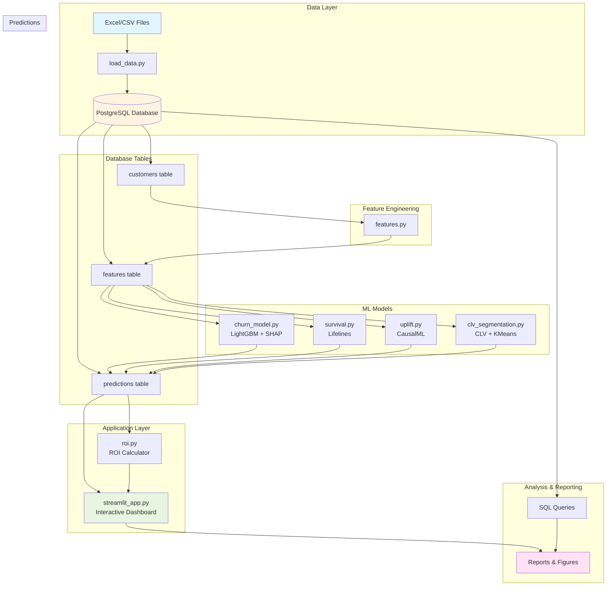
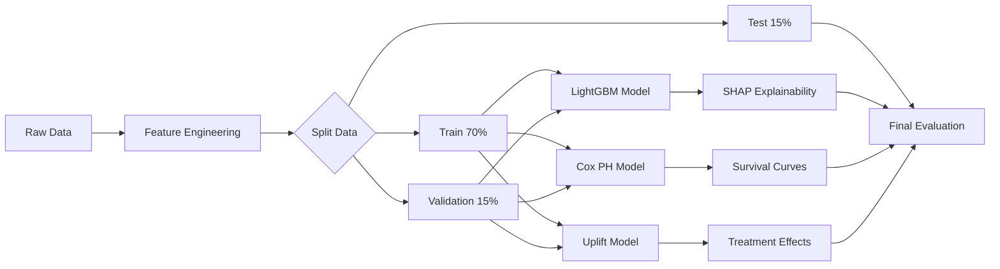

# System Architecture & Data Documentation

## System Architecture Diagram

## Data Flow

1. **Ingestion**: Raw data (Excel) → Python cleaning → PostgreSQL
2. **Feature Engineering**: Raw features → Engineered features → Database
3. **Modeling**: Features → ML models → Predictions → Database
4. **Application**: Database → Streamlit → Interactive dashboards
5. **Analysis**: Database → SQL queries → Reports

## Database Schema

### Table: `customers`

Core customer information, demographics, services, and churn status.

| Column | Type | Description | Constraints |
|--------|------|-------------|-------------|
| customer_id | VARCHAR(50) | Unique customer identifier | PRIMARY KEY |
| gender | VARCHAR(10) | Customer gender | - |
| senior_citizen | INTEGER | Senior citizen flag (0/1) | CHECK (0 or 1) |
| partner | VARCHAR(3) | Has partner (Yes/No) | CHECK (Yes/No) |
| dependents | VARCHAR(3) | Has dependents (Yes/No) | CHECK (Yes/No) |
| tenure | INTEGER | Months with company | CHECK (>= 0) |
| contract | VARCHAR(20) | Contract type | CHECK (Month-to-month, One year, Two year) |
| phone_service | VARCHAR(3) | Has phone service | CHECK (Yes/No) |
| multiple_lines | VARCHAR(20) | Multiple phone lines | - |
| internet_service | VARCHAR(20) | Internet service type | DSL, Fiber optic, No |
| online_security | VARCHAR(20) | Has online security | Yes, No, No internet service |
| online_backup | VARCHAR(20) | Has online backup | Yes, No, No internet service |
| device_protection | VARCHAR(20) | Has device protection | Yes, No, No internet service |
| tech_support | VARCHAR(20) | Has tech support | Yes, No, No internet service |
| streaming_tv | VARCHAR(20) | Has streaming TV | Yes, No, No internet service |
| streaming_movies | VARCHAR(20) | Has streaming movies | Yes, No, No internet service |
| paperless_billing | VARCHAR(3) | Uses paperless billing | CHECK (Yes/No) |
| payment_method | VARCHAR(50) | Payment method | Electronic check, Mailed check, Bank transfer, Credit card |
| monthly_charges | NUMERIC(10,2) | Monthly charges in dollars | CHECK (>= 0) |
| total_charges | NUMERIC(10,2) | Total charges to date | CHECK (>= 0) |
| churn | INTEGER | Churn flag (0=retained, 1=churned) | CHECK (0 or 1) |
| loaded_at | TIMESTAMP | Record load timestamp | DEFAULT CURRENT_TIMESTAMP |

**Indexes:**
- `idx_customers_churn` on `churn`
- `idx_customers_contract` on `contract`
- `idx_customers_tenure` on `tenure`
- `idx_customers_internet_service` on `internet_service`

### Table: `features`

Engineered features for machine learning models.

| Column | Type | Description | Constraints |
|--------|------|-------------|-------------|
| customer_id | VARCHAR(50) | Links to customers | PRIMARY KEY, FOREIGN KEY |
| tenure_months | INTEGER | Tenure (same as raw) | - |
| tenure_bucket | VARCHAR(20) | Tenure category | '0-12', '13-24', '25-48', '49+' |
| charges_per_tenure_month | NUMERIC(10,4) | Monthly charges / tenure | - |
| charge_change_ratio | NUMERIC(10,4) | Monthly / (Total/tenure) | Proxy for spend trend |
| service_count | INTEGER | Number of services | CHECK (>= 0) |
| has_phone_service | INTEGER | Binary phone flag | CHECK (0 or 1) |
| has_internet_service | INTEGER | Binary internet flag | CHECK (0 or 1) |
| has_online_security | INTEGER | Binary security flag | CHECK (0 or 1) |
| has_tech_support | INTEGER | Binary tech support flag | CHECK (0 or 1) |
| has_streaming_services | INTEGER | Has TV or movies | CHECK (0 or 1) |
| is_month_to_month | INTEGER | Month-to-month contract | CHECK (0 or 1) |
| is_one_year | INTEGER | One year contract | CHECK (0 or 1) |
| is_two_year | INTEGER | Two year contract | CHECK (0 or 1) |
| has_autopay | INTEGER | Automatic payment | CHECK (0 or 1) |
| potential_complaint_flag | INTEGER | Complaint proxy | CHECK (0 or 1) |
| created_at | TIMESTAMP | Feature creation time | DEFAULT CURRENT_TIMESTAMP |

**Feature Definitions:**
- **tenure_bucket**: Categorical grouping of tenure for analysis
- **charges_per_tenure_month**: Average monthly revenue per tenure month
- **charge_change_ratio**: Ratio of current monthly charges to historical average (>1 means increasing spend)
- **service_count**: Total number of services subscribed (phone + internet + add-ons)
- **potential_complaint_flag**: Proxy for dissatisfaction = month-to-month + no tech support + no online security

**Indexes:**
- `idx_features_tenure_bucket` on `tenure_bucket`
- `idx_features_service_count` on `service_count`

### Table: `predictions`

Model predictions and analytical results.

| Column | Type | Description | Constraints |
|--------|------|-------------|-------------|
| customer_id | VARCHAR(50) | Links to customers | PRIMARY KEY, FOREIGN KEY |
| churn_probability | NUMERIC(5,4) | Churn probability [0-1] | CHECK (BETWEEN 0 AND 1) |
| churn_prediction | INTEGER | Binary churn prediction | CHECK (0 or 1) |
| churn_model_version | VARCHAR(50) | Model version identifier | - |
| median_survival_months | NUMERIC(10,2) | Median survival time | - |
| expected_lifetime_months | NUMERIC(10,2) | Expected remaining lifetime | - |
| survival_12m | NUMERIC(5,4) | 12-month survival probability | - |
| survival_24m | NUMERIC(5,4) | 24-month survival probability | - |
| survival_36m | NUMERIC(5,4) | 36-month survival probability | - |
| clv_predicted | NUMERIC(12,2) | Predicted customer lifetime value | - |
| clv_historical | NUMERIC(12,2) | Historical CLV | - |
| segment_id | INTEGER | Cluster segment ID | - |
| segment_name | VARCHAR(50) | Segment name | High-value at-risk, etc. |
| uplift_score | NUMERIC(10,6) | Treatment effect estimate | - |
| uplift_segment | VARCHAR(50) | Uplift category | Persuadables, Sure Things, etc. |
| predicted_at | TIMESTAMP | Prediction timestamp | DEFAULT CURRENT_TIMESTAMP |
| updated_at | TIMESTAMP | Last update timestamp | DEFAULT CURRENT_TIMESTAMP |

**Indexes:**
- `idx_predictions_churn_prob` on `churn_probability`
- `idx_predictions_segment` on `segment_name`
- `idx_predictions_uplift_segment` on `uplift_segment`

## Views

### `customer_profile`
Combines all three tables for a complete customer view.

### `high_risk_customers`
Filters customers with churn_probability >= 0.5, ordered by CLV.

## Data Dictionary

### Categorical Variables

| Variable | Values | Description |
|----------|--------|-------------|
| gender | Male, Female | Customer gender |
| partner | Yes, No | Has partner/spouse |
| dependents | Yes, No | Has dependents |
| phone_service | Yes, No | Has phone service |
| multiple_lines | Yes, No, No phone service | Multiple phone lines |
| internet_service | DSL, Fiber optic, No | Type of internet |
| online_security | Yes, No, No internet service | Security add-on |
| online_backup | Yes, No, No internet service | Backup add-on |
| device_protection | Yes, No, No internet service | Device protection |
| tech_support | Yes, No, No internet service | Tech support service |
| streaming_tv | Yes, No, No internet service | TV streaming |
| streaming_movies | Yes, No, No internet service | Movie streaming |
| contract | Month-to-month, One year, Two year | Contract type |
| paperless_billing | Yes, No | Paperless billing |
| payment_method | Electronic check, Mailed check, Bank transfer (automatic), Credit card (automatic) | Payment method |

### Numeric Variables

| Variable | Type | Range | Description |
|----------|------|-------|-------------|
| senior_citizen | Binary | 0, 1 | 1 = senior citizen |
| tenure | Integer | 0-72 | Months with company |
| monthly_charges | Float | 18.25 - 118.75 | Monthly charges ($) |
| total_charges | Float | 0 - 8684.80 | Total charges to date ($) |
| churn | Binary | 0, 1 | 1 = churned |

### Target Variable

**churn**: Binary classification target
- 0 = Customer retained
- 1 = Customer churned
- Class distribution: ~73% retained, ~27% churned (imbalanced)

## Model Pipeline

## Technology Stack Details

### Database Layer
- **PostgreSQL 14+**: ACID-compliant relational database
- **psycopg2**: Low-level Python adapter
- **SQLAlchemy**: ORM and connection pooling

### ML Stack
- **pandas**: Data manipulation
- **numpy**: Numerical computing
- **scikit-learn**: Preprocessing, metrics, clustering
- **LightGBM**: Gradient boosting (churn model)
- **SHAP**: Model explainability
- **lifelines**: Survival analysis (Kaplan-Meier, Cox PH)
- **causalml**: Uplift modeling (T-Learner, S-Learner)

### Visualization
- **matplotlib**: Static plots
- **seaborn**: Statistical visualizations
- **plotly**: Interactive charts

### Application
- **Streamlit**: Web dashboard
- **python-dotenv**: Environment management

## File Naming Conventions

- **Models**: `{model_type}_model.pkl` (e.g., `churn_model.pkl`)
- **Data**: `{stage}_{description}.csv` (e.g., `processed_features.csv`)
- **Reports**: `{date}_{report_type}.html` (e.g., `2026-11-19_eda_report.html`)

## Version Control

- Git repository with `.gitignore` for sensitive files
- `.env` files never committed
- Large data files optionally ignored
- Models versioned with metadata

## Security Considerations

1. **Credentials**: Stored in `.env`, never in code
2. **Database**: Local PostgreSQL with user-level access control
3. **Data Privacy**: PII handling per compliance requirements
4. **Model Access**: Predictions stored in database with access controls
